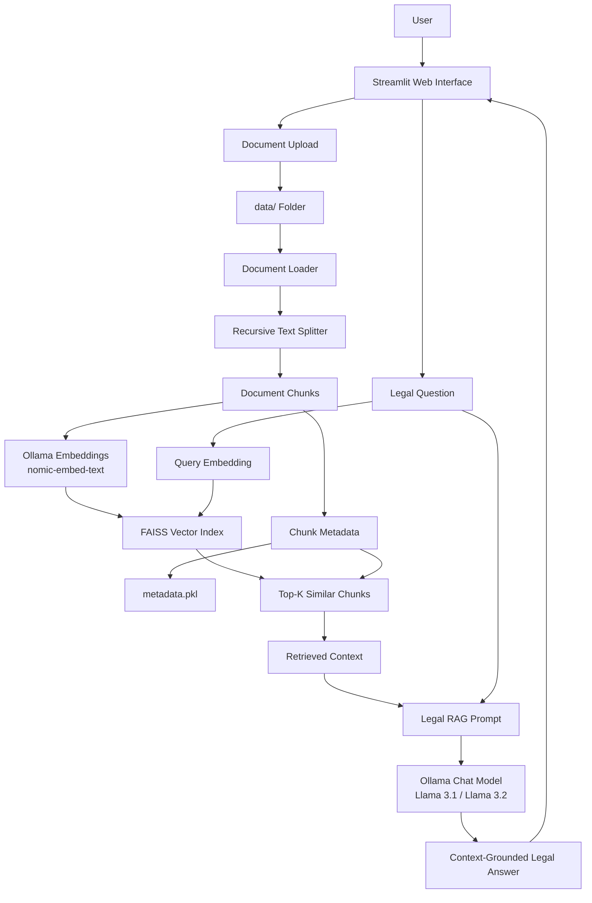
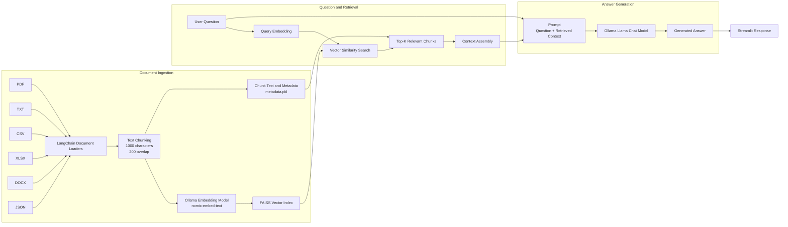
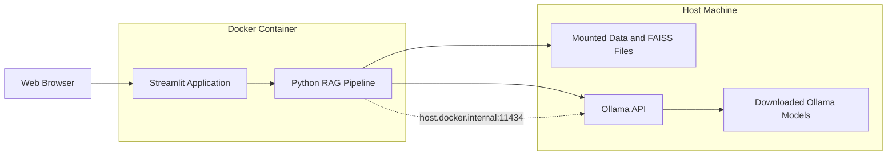

An AI-powered legal document search application that helps users search uploaded legal documents and receive context-grounded answers to natural-language questions. The application uses Retrieval-Augmented Generation (RAG), Ollama for local embeddings and language generation, and FAISS for vector similarity search.

## Abstract

Legal information is often distributed across large collections of documents, making it difficult and time-consuming to locate relevant passages and understand their contents. **Legal RAG** addresses this challenge by providing a document-based question-answering system. Users can upload legal documents in supported formats and ask questions through a Streamlit web interface.

The application extracts text from uploaded files, divides it into manageable overlapping chunks, converts those chunks into vector embeddings using Ollama's `nomic-embed-text` model, and stores the vectors in a FAISS index. When a user asks a question, the system embeds the query, retrieves the most relevant document chunks through similarity search, and supplies the retrieved context to an Ollama Llama chat model. The model then generates an answer grounded in the retrieved material.

The system is designed to make searching legal documents more convenient and efficient. Its responses are based on the documents available to the application; they should not be treated as a substitute for professional legal advice.

## Key Features

- **Multiple document formats:** Upload PDF, TXT, CSV, XLSX, DOCX, and JSON files.
- **Natural-language questions:** Ask questions in everyday language instead of searching manually through files.
- **Retrieval-Augmented Generation:** Retrieve relevant document passages before generating an answer.
- **Semantic search:** Find content by meaning using embeddings and FAISS similarity search.
- **Local model integration:** Use Ollama for embedding generation and chat completion.
- **Persistent vector storage:** Save the FAISS index and chunk metadata for reuse.
- **Interactive interface:** Upload documents and view answers through Streamlit.

## Technology Stack

| Technology | Purpose |
|---|---|
| Python | Core application and RAG pipeline |
| Streamlit | Web-based user interface |
| LangChain document loaders | Load and convert supported files into documents |
| LangChain text splitters | Split documents into overlapping chunks |
| Ollama | Run embedding and chat models locally |
| `nomic-embed-text` | Convert document chunks and questions into embeddings |
| Llama 3.1 / Llama 3.2 | Generate answers from retrieved context |
| FAISS (`faiss-cpu`) | Store vectors and perform similarity search |
| Pickle | Persist chunk text and metadata |
| Docker | Containerize and run the application |

## Supported Input Documents

The application is configured to accept the following formats:

| Format | Extension |
|---|---|
| PDF | `.pdf` |
| Text | `.txt` |
| CSV | `.csv` |
| Excel | `.xlsx` |
| Word | `.docx` |
| JSON | `.json` |

Actual support depends on the document loaders and file-handling code configured in the project.

## System Architecture

The application has two main phases:

1. **Document ingestion:** Uploaded documents are loaded, split into chunks, embedded, and indexed in FAISS.
2. **Question answering:** A user's question is embedded, relevant chunks are retrieved, and an LLM generates an answer using that context.

### 1. High-Level Application Architecture



### 2. RAG Pipeline Architecture



### 3. Deployment Architecture



## How the Application Works

### A. Document Ingestion

1. The user uploads one or more supported legal documents through Streamlit.
2. Uploaded files are saved in the `data/` directory.
3. The document loader reads each file and extracts its text.
4. The recursive text splitter divides the extracted text into chunks. The configured example uses a chunk size of **1,000 characters** and an overlap of **200 characters**.
5. Ollama's `nomic-embed-text` model converts each chunk into a numerical embedding.
6. FAISS stores the embeddings for efficient similarity search.
7. The corresponding chunk text and metadata are saved in `faiss_store/metadata.pkl`.

### B. Question Retrieval and Answer Generation

1. The user enters a legal question in the Streamlit interface.
2. The question is converted into an embedding using the same embedding model.
3. FAISS compares the question vector with the stored document vectors.
4. The system retrieves the configured **Top-K** most similar chunks.
5. The retrieved text is assembled into a context section.
6. The question and retrieved context are inserted into the legal RAG prompt.
7. The prompt is sent to the Ollama Llama chat model.
8. The model generates an answer based on the supplied context.
9. Streamlit displays the generated answer to the user.

> **Important:** Retrieval quality depends on the uploaded documents, chunking configuration, embedding model, and retrieval settings. The LLM can still produce inaccurate output, so users should verify important legal information against the original documents and consult a qualified legal professional when necessary.

## Project Components

| Component | Responsibility | Implementation |
|---|---|---|
| Streamlit UI | Document upload and question interface | `streamlit_app.py` |
| CLI entry point | Direct application invocation or example usage | `app.py` |
| Document loader | Load supported files as LangChain documents | `src/data_loader.py` |
| Text splitter | Divide documents into overlapping chunks | `langchain_text_splitters` |
| Embedding pipeline | Generate vector representations | `src/embedding.py` |
| Embedding model | Create text embeddings | Ollama `nomic-embed-text` |
| Vector store | Build, save, and search the vector index | `src/vectorstore.py` |
| Similarity search | Retrieve relevant document chunks | FAISS |
| Metadata store | Preserve chunk text and associated metadata | `faiss_store/metadata.pkl` |
| RAG search | Retrieve context and generate answers | `src/search.py` |
| Chat model | Generate context-grounded responses | Ollama `llama3.1` or `llama3.2` |

## Configuration

The application uses the following environment variables:

| Variable | Description | Example default |
|---|---|---|
| `OLLAMA_BASE_URL` | Ollama API endpoint | `http://host.docker.internal:11434` |
| `OLLAMA_EMBED_MODEL` | Embedding model name | `nomic-embed-text` |
| `OLLAMA_LLM_MODEL` | Chat model name | `llama3.1` or `llama3.2` |

Set these values according to your local setup. The Ollama model names must match models available in your Ollama installation.

## Setup and Installation

### Prerequisites

- Python 3.11
- Ollama installed and running
- Docker Desktop (if running the containerized version)
- The required Ollama embedding and chat models

### 1. Clone the repository

```bash
git clone <repository-url>
cd <project-directory>
```

Replace the placeholders with your repository URL and project directory.

### 2. Install Python dependencies

Create and activate a virtual environment if desired, then install the packages:

```bash
pip install -r requirements.txt
```

### 3. Download the Ollama models

Pull the embedding model:

```bash
ollama pull nomic-embed-text
```

Pull the chat model selected for your application:

```bash
ollama pull llama3.2
```

If your configuration uses Llama 3.1 instead, pull that model:

```bash
ollama pull llama3.1
```

Make sure Ollama is running before starting the application.

### 4. Run the Streamlit application

```bash
streamlit run streamlit_app.py
```

Open the local URL printed by Streamlit, typically:

```text
http://localhost:8501
```

## Running with Docker

The application can also be run inside Docker while Ollama runs on the host machine.

Build the Docker image:

```bash
docker build -t legal-rag .
```

Run the container from Windows Command Prompt:

```bat
docker run --rm -p 8501:8501 -v "%cd%/faiss_store:/app/faiss_store" -v "%cd%/data:/app/data" --add-host=host.docker.internal:host-gateway legal-rag
```

The volume mounts allow the container to access and persist the source documents and FAISS data on the host. The `host.docker.internal` host-gateway mapping allows the container to reach the Ollama service running on the host.

Ensure that:

- Ollama is running on the host and listening on port `11434`.
- The configured models have already been pulled.
- The Docker application uses the correct Ollama base URL.
- The project paths in the volume mounts match the application's paths inside the container.

Then open:

```text
http://localhost:8501
```

## Persisted Data and Storage

| Path | Description |
|---|---|
| `data/` | Uploaded source documents |
| `faiss_store/faiss.index` | Persisted FAISS vector index |
| `faiss_store/metadata.pkl` | Stored chunk text and metadata |

The `data/` and `faiss_store/` directories should be preserved if you want to reuse uploaded documents and the previously built vector index. If the index is deleted or becomes inconsistent with its metadata, rebuild the vector store from the source documents.

## Example Usage

1. Start Ollama and ensure the required models are available.
2. Start the Streamlit application.
3. Upload legal documents in one of the supported formats.
4. Allow the application to process and index the documents.
5. Enter a question related to the uploaded material.
6. Review the answer and verify important details in the original documents.

Example questions:

- What are the key provisions mentioned in this document?
- What obligations does the agreement place on each party?
- What is the termination clause?
- Which section discusses dispute resolution?
- Summarize the relevant passage about compensation.

The answers depend on the documents uploaded to the application.

## Limitations and Responsible Use

- The application can answer only from information successfully extracted and retrieved from its available documents.
- Poor-quality scans, unsupported document structures, tables, or formatting may affect text extraction.
- Similarity search may fail to retrieve the most relevant passage for vague or complex questions.
- Generated answers may be incomplete or incorrect and must be independently verified.
- The application is an information-retrieval and assistance tool, not a legal decision-making system or a replacement for a lawyer.
- Do not upload confidential or sensitive legal documents unless your data-handling and deployment arrangements are appropriate.

## Future Enhancements

Possible improvements include:

- Displaying source document names and page or section references with answers.
- Adding filters by document, case, date, or legal category.
- Supporting scanned PDFs through OCR.
- Adding evaluation datasets to measure retrieval relevance and answer quality.
- Improving chunking and retrieval with metadata filtering and reranking.
- Adding user authentication and document-level access controls.

## License
